# Rogic Reworked

A reworked build of **Rogic 4.0.1**, the block-based ("chip") programming tool for ROBOROBO school robot kits. You build a program by dragging chips onto the canvas. Rogic turns it into C, compiles it for the kit's ATmega8 controller and downloads it to the robot.

This is an unofficial, modified build. Rogic is © ROBOROBO Co., Ltd.

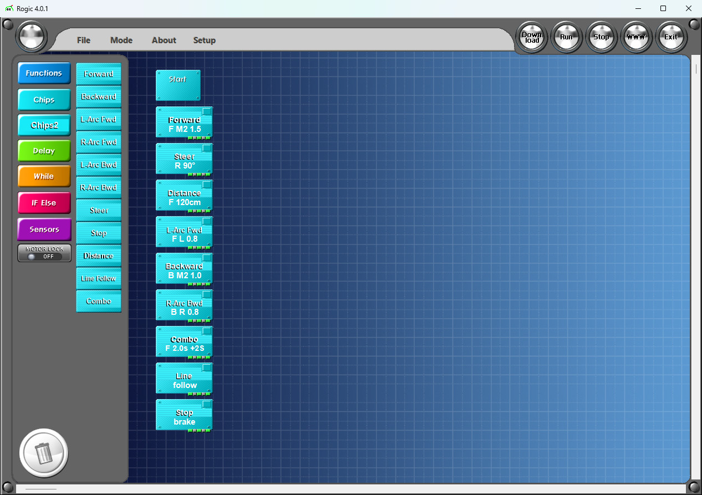

## New in this build

### Drive chips (the *Chips2* palette tab)

A new palette tab with eleven chips for driving a two-wheeled robot without wiring up individual motors by hand.

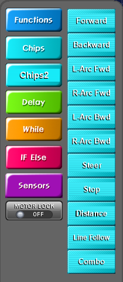

| Chip | What it does |
| --- | --- |
| **Forward** / **Backward** | Run the selected motors (2- or 4-motor robot) at a chosen speed, optionally for a set number of seconds. |
| **L-Arc Fwd**, **R-Arc Fwd**, **L-Arc Bwd**, **R-Arc Bwd** | Drive one side only, so the robot pivots around the other wheel. |
| **Steer** | Turn left or right by a number of **degrees**. The turn time comes from the robot's calibrated full-spin time, with an optional multiplier. |
| **Stop** | Stop both wheels by **brake** (hold still, so a timed move ends exactly where the timing says) or **coast** (roll free). It can also wait afterwards. |
| **Drive Distance** | Drive forward or backward a distance in **centimetres**. The run time comes from the calibrated 100 cm time and is scaled by speed. The dialog warns when the speed is too low for a reliable distance. |
| **Line Follow** | A complete two-sensor line follower in one chip. See below. |
| **Combo** (Drive + Servo) | Set up to five servos (0–214), give them time to reach position, then drive forward, backward or spin for a set time. Afterwards the motors either stop or keep running. |

Every drive chip applies the robot's wheel-balance correction and the Motor lock setting (both described below). Each chip on the canvas shows its key setting, such as `R 90°`, `F 120cm` or `brake`. Click the small square in its top-right corner to open its dialog.

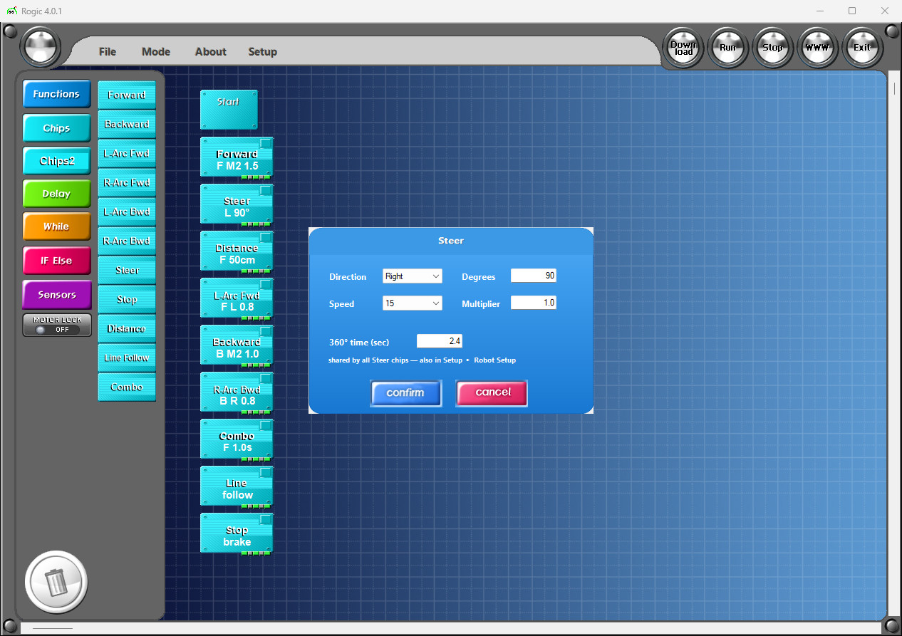

| Forward | Forward, 4-motor robot |
| --- | --- |
| 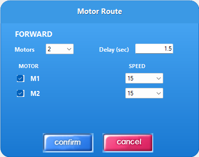 | 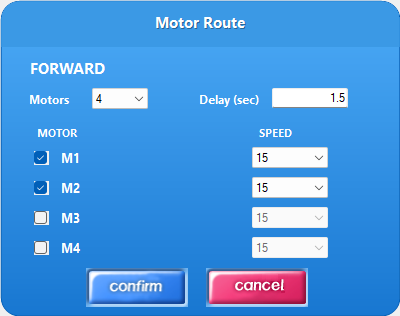 |
| **Backward** | **Steer** |
| 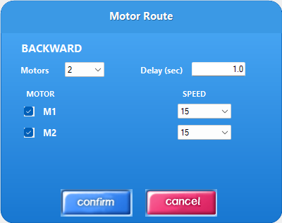 | 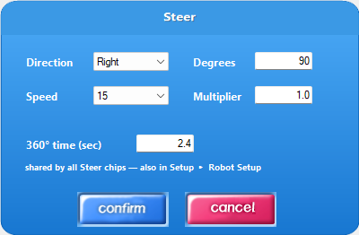 |
| **Left arc, forward** | **Right arc, backward** |
| 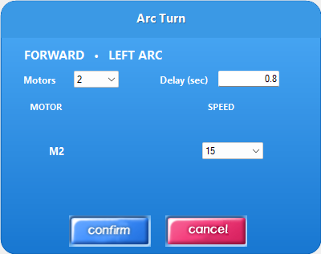 | 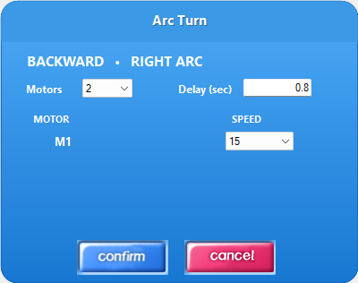 |
| **Stop: brake** | **Stop: coast, then wait** |
|  | 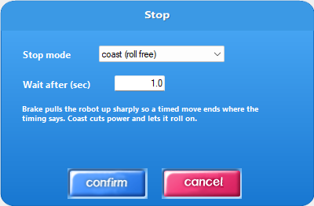 |
| **Drive Distance** | **Combo (Drive + Servo)** |
| 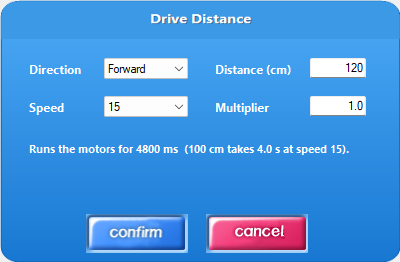 | 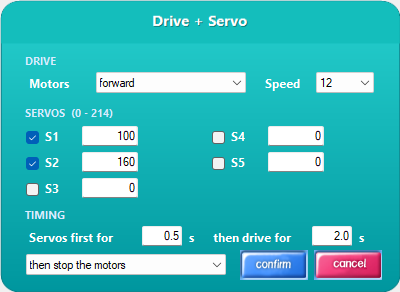 |

### Line Follow chip

- **Basic dialog:** choose whether each motor is normal or reversed. If the robot drives backwards, reverse both; if it spins on the spot, reverse one.
- **Advanced settings…** set:
  - the left and right sensor ports (IN1–IN7)
  - whether the sensor reads HIGH or LOW over black
  - whether the line runs between the sensors or under both
  - base speed, turn speed and loop delay
  - the run mode: **forever**, **for N seconds** or **to the finish mark**
- The generated C is commented line by line ("drifting right, line under the left sensor"…), so it can be read in the source editor.

| Line Follow | Advanced settings |
| --- | --- |
| 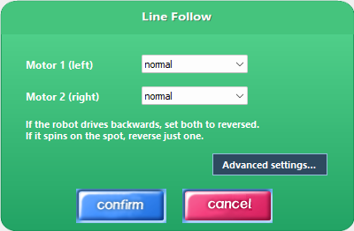 | 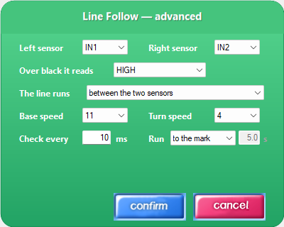 |

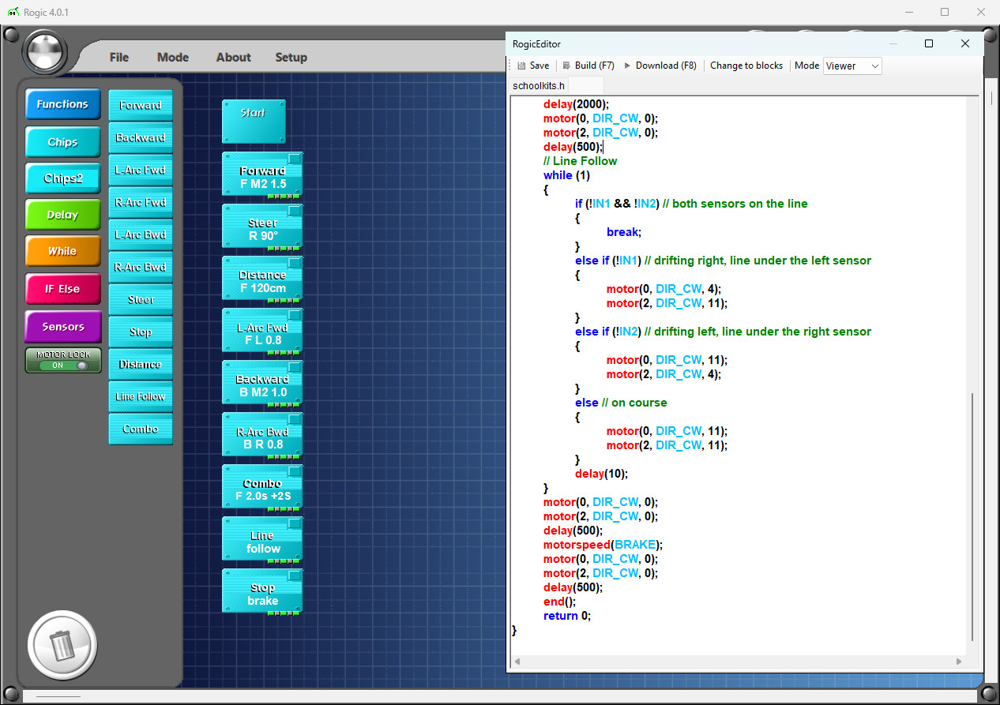

### Robot Setup (Setup ▸ Robot Setup…)

Calibrate the robot once, and every drive chip uses the result.

- **Wheel balance:** pick the faster wheel and the percentage it should run at. Drive chips slow that wheel so the robot tracks straight. The dialog previews the speeds actually sent to each wheel.
- **Movement timing:**
  - **Full spin (sec)** is used by Steer.
  - **100 cm (sec)** is used by Drive Distance.
- **Test spin** / **Test straight:** replace the current program with a single calibration chip (a 360° Steer or a 100 cm Drive Distance). Download it, watch where the robot stops, and adjust the timing until it's right.
- The calibration is kept in undo/redo and in the crash-recovery autosave. It is **not** written to saved `.rpj` files, so set it again after reopening a project.

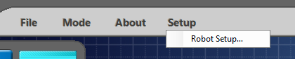

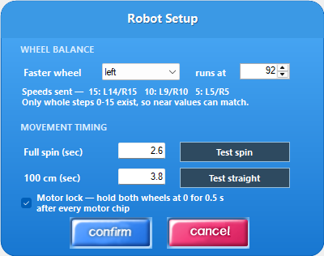

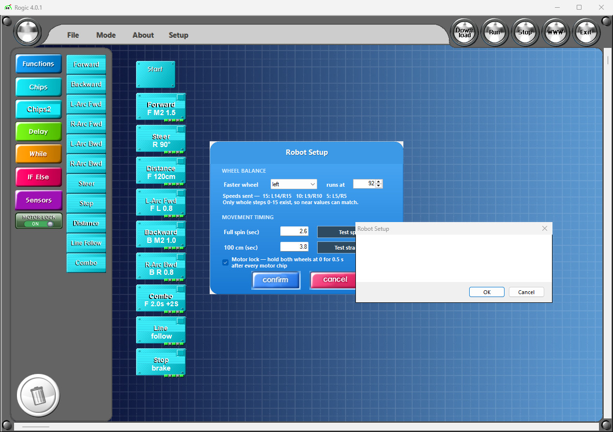

| After *Test spin* | After *Test straight* |
| --- | --- |
| 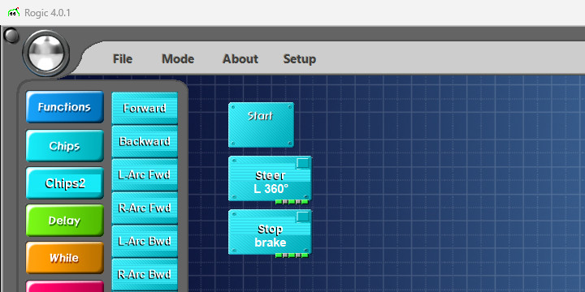 |  |

### Motor lock

A **MOTOR LOCK** switch in the main window, also in Robot Setup. When it is ON, every motor chip ends by setting both motors to 0 and holding for 0.5 s, so each move runs separately instead of blending into the next. Like the calibration, it isn't stored in `.rpj` files.

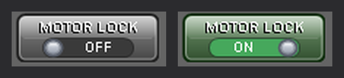

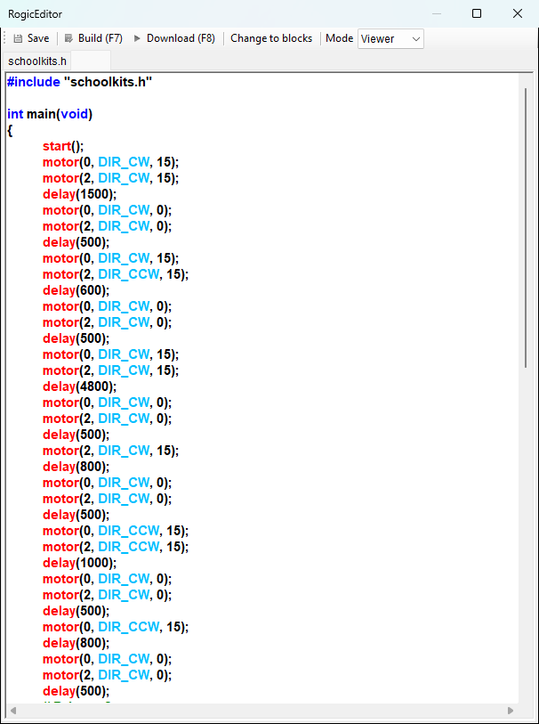

### Look and feel

- New chips and their dialogs use a colour-coded theme by category: motor blue, sensor green, servo teal, delay amber and so on.
- When a palette tab holds more chips than fit, it scrolls with the **mouse wheel**.
- If a chip or dialog image is missing from the resources, Rogic draws a themed replacement instead of failing.

## Requirements

- Windows with **.NET Framework 4.6.2** or newer.
- **WinAVR-20100110** installed at `C:\WinAVR-20100110`, with its `bin` and `utils\bin` folders on `PATH`. Rogic calls `avr-gcc` and `avr-objcopy` to build the program.
- **CP210x USB-to-UART driver** for the robot's download cable. The driver is included in [Driver/CP210X](Driver/CP210X): use `Universal` on Windows 10/11 and `Origin` on older systems.

## Running

Run `Rogic.exe` from this folder. The DLLs, `Lib/` and `RogicRes/` must stay next to it. UI languages: English, Korean, Chinese and Russian.

If Rogic crashes, the error details are written to `runtime_error.log` (or `startup_error.log`) next to `Rogic.exe`.

## Layout

| Path | Contents |
| --- | --- |
| `Rogic.exe` | Main application |
| `ChipsDialogue.dll`, `ClientArea.dll`, `FixedArea.dll`, … | UI, chip dialogs, palette and canvas |
| `ISPDownloader.dll`, `STK500.dll` | Program download to the controller |
| `Bluetooth/` | Bluetooth module setup (master/slave pairing) |
| `Lib/` | AVR libraries and headers linked into every program (`libm8Api.a`, `libKitMD2013.a`, `schoolKits.h`) |
| `RogicRes/` | Cursors and icon |
| `Driver/CP210X/` | USB serial driver for the download cable |
| `msvcr100*.dll`, `shared32/64.dll` | Native runtime dependencies |
| `docs/screenshots/` | The screenshots in this README |

## Notes

The repository holds only compiled binaries, not source code. The reworked parts live in `Rogic.exe`, `ChipsDialogue.dll`, `ClientArea.dll` and `FixedArea.dll`.
