# Rogic Reworked

A reworked build of **Rogic 4.0.1**, the block-based ("chip") programming tool for ROBOROBO school robot kits. You build a program by dragging chips onto the canvas. Rogic turns it into C, compiles it for the kit's ATmega8 controller and downloads it to the robot.

This is an unofficial, modified build. Rogic is © ROBOROBO Co., Ltd.

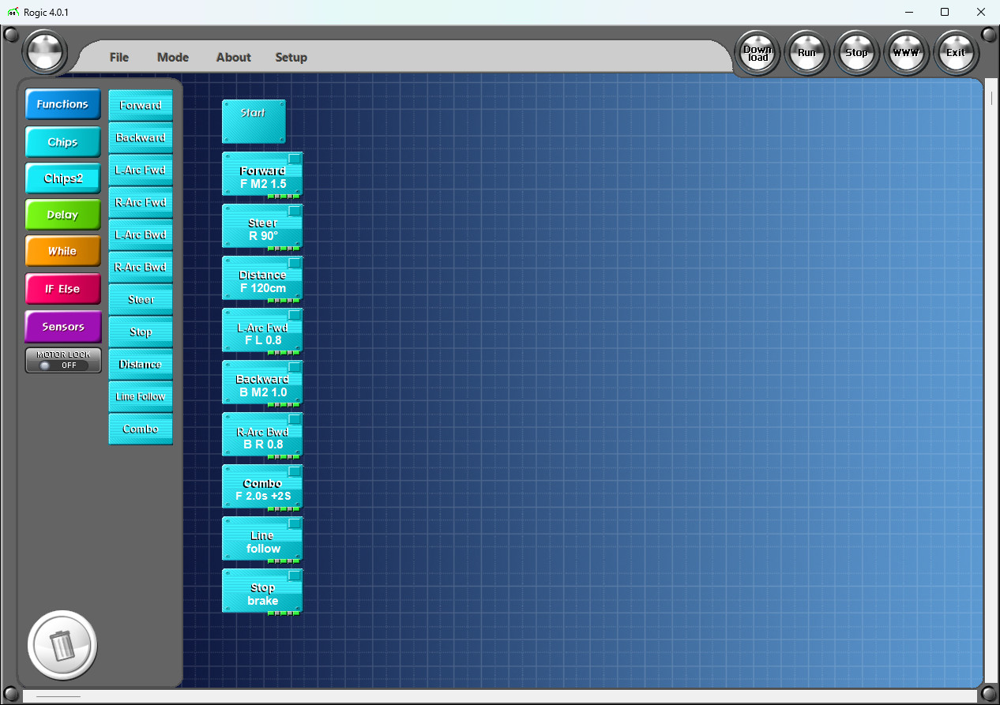

## New in this build

### Drive chips (the *Chips2* palette tab)

A new palette tab with eleven chips for driving a two-wheeled robot without wiring up individual motors by hand.

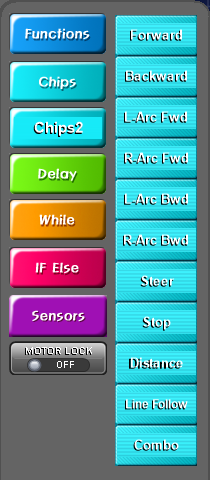

| Chip | What it does |
| --- | --- |
| **Forward** / **Backward** | Run the selected motors (2- or 4-motor robot) at a chosen speed, optionally for a set number of seconds. |
| **L-Arc Fwd**, **R-Arc Fwd**, **L-Arc Bwd**, **R-Arc Bwd** | Drive one side only, so the robot pivots around the other wheel. |
| **Steer** | Turn left or right by a number of **degrees**. The turn time comes from the robot's calibrated full-spin time, with an optional multiplier. |
| **Stop** | Stop both wheels by **brake** (hold still, so a timed move ends exactly where the timing says) or **coast** (roll free). It can also wait afterwards. |
| **Drive Distance** | Drive forward or backward a distance in **centimetres**. The run time comes from the calibrated 100 cm time and is scaled by speed. The dialog warns when the speed is too low for a reliable distance. |
| **Line Follow** | A complete two-sensor line follower in one chip. See below. |
| **Combo** (Drive + Servo) | Set up to five servos (0–214), give them time to reach position, then drive forward, backward or spin for a set time. Afterwards the motors either stop or keep running. |

Every drive chip applies the robot's wheel-balance correction and the Motor lock setting (both described below). Each chip on the canvas shows its key setting, such as `R 90°`, `F 120cm` or `brake`. Click the small square in its top-right corner to open its dialog.

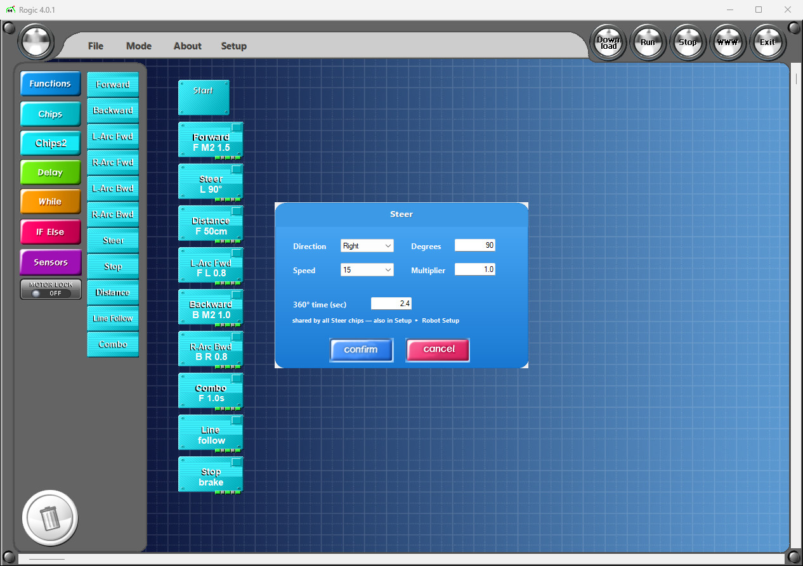

| Forward | Forward, 4-motor robot |
| --- | --- |
| 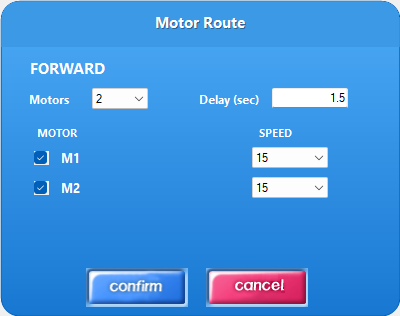 | 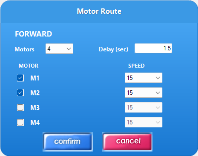 |
| **Backward** | **Steer** |
| 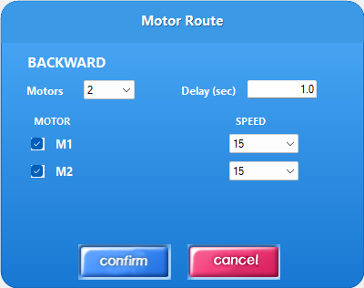 | 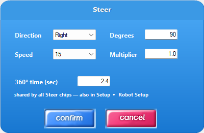 |
| **Left arc, forward** | **Right arc, backward** |
| 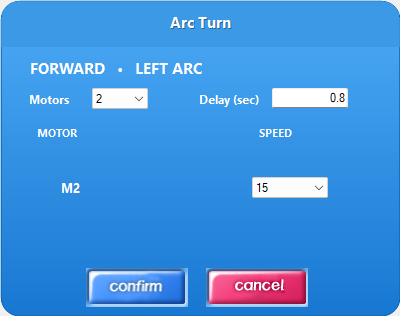 | 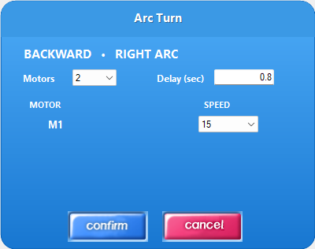 |
| **Stop: brake** | **Stop: coast, then wait** |
| 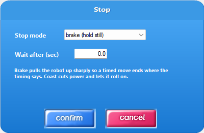 |  |
| **Drive Distance** | **Combo (Drive + Servo)** |
| 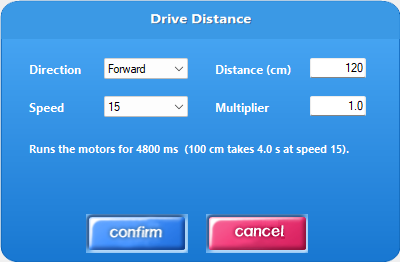 | 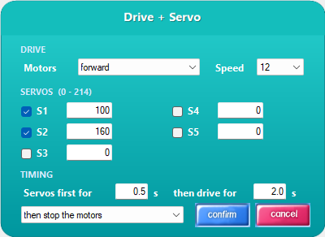 |

### Line Follow chip

- **Basic dialog:** choose whether each motor is normal or reversed. If the robot drives backwards, reverse both; if it spins on the spot, reverse one.
- **Advanced settings…** set:
  - the left and right sensor ports (IN1–IN7)
  - whether the sensor reads HIGH or LOW over black
  - whether the line runs between the sensors or under both
  - base speed, turn speed and loop delay
  - the run mode: **forever**, **for N seconds** or **to the finish mark**
- The generated C is commented line by line ("drifting right, line under the left sensor"…), so it can be read in the source editor.

| Line Follow | Advanced settings |
| --- | --- |
| 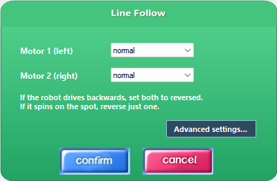 | 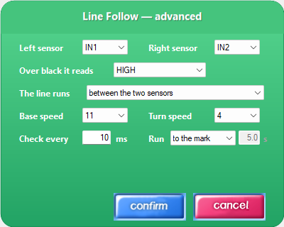 |

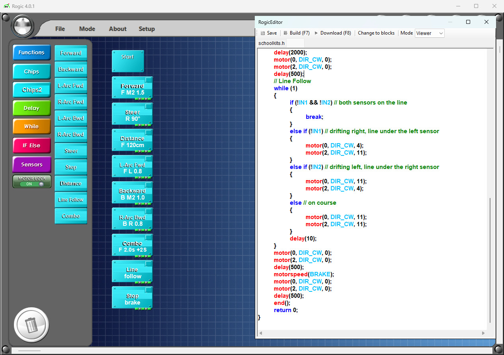

### Robot Setup (Setup ▸ Robot Setup…)

Calibrate the robot once, and every drive chip uses the result.

- **Wheel balance:** pick the faster wheel and the percentage it should run at. Drive chips slow that wheel so the robot tracks straight. The dialog previews the speeds actually sent to each wheel.
- **Movement timing:**
  - **Full spin (sec)** is used by Steer.
  - **100 cm (sec)** is used by Drive Distance.
- **Test spin** / **Test straight:** replace the current program with a single calibration chip (a 360° Steer or a 100 cm Drive Distance). Download it, watch where the robot stops, and adjust the timing until it's right.
- The calibration is saved in the project's `.rpj` file, and is also kept in undo/redo and in the crash-recovery autosave.

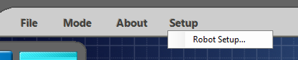

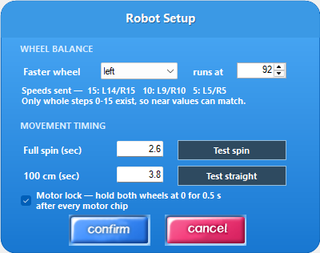

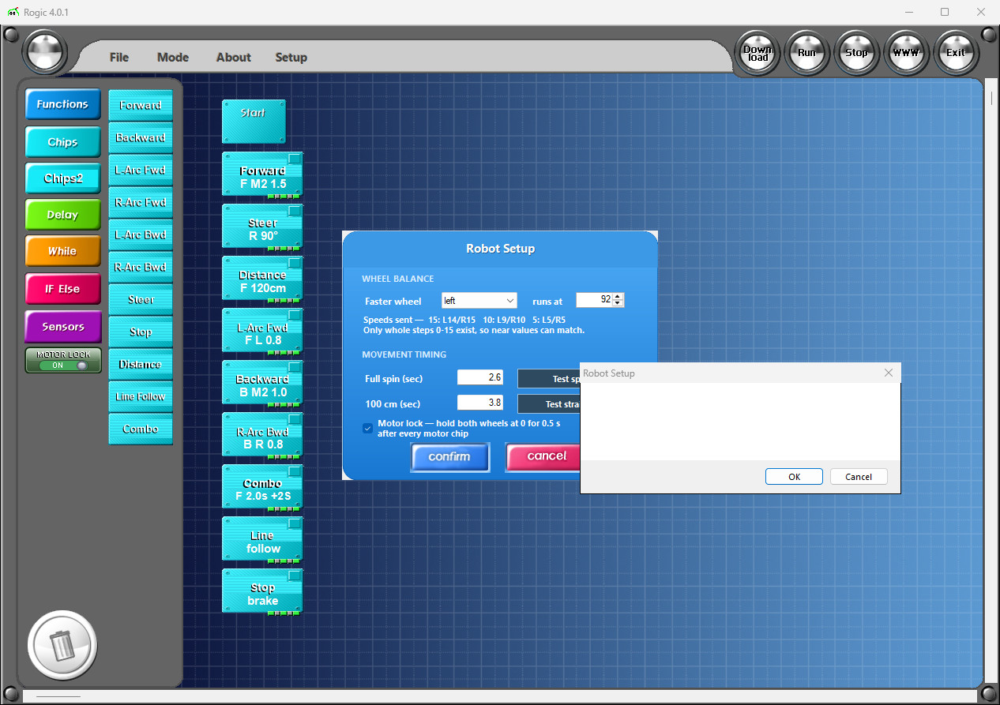

| After *Test spin* | After *Test straight* |
| --- | --- |
| 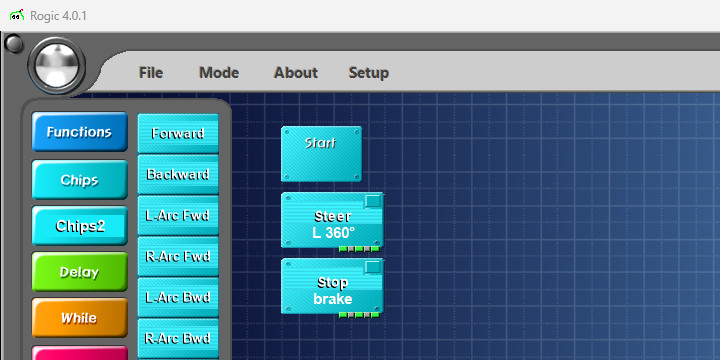 |  |

### Motor lock

A **MOTOR LOCK** switch in the main window, also in Robot Setup. When it is ON, every motor chip ends by setting both motors to 0 and holding for 0.5 s, so each move runs separately instead of blending into the next. If a motor chip has no time of its own and is followed by a Delay chip, the lock comes after that delay and stops only the motors the chip used. Like the calibration, the setting is saved in the `.rpj` file.

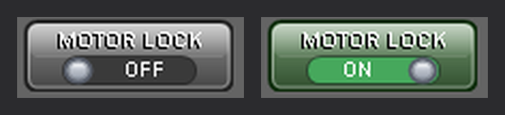

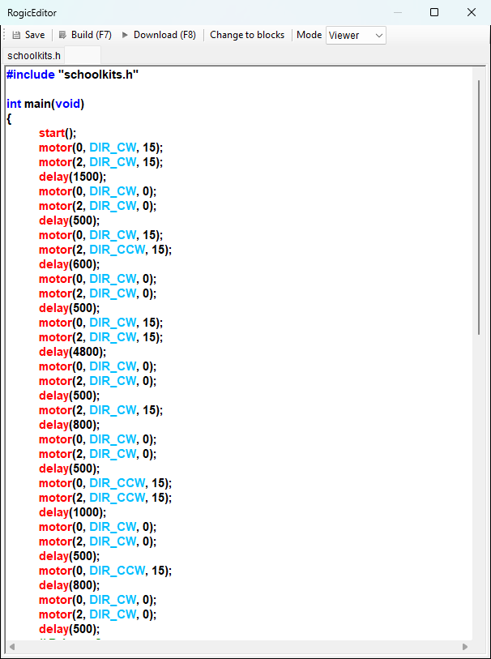

### Look and feel

- New chips and their dialogs use a colour-coded theme by category: motor blue, sensor green, servo teal, delay amber and so on.
- When a palette tab holds more chips than fit, it scrolls with the **mouse wheel**.
- If a chip or dialog image is missing from the resources, Rogic draws a themed replacement instead of failing.

### Greek chips and menus

Rogic can show its chips in **Greek**: the chip labels on the palette and canvas, the chip dialogs, the palette tabs, the File/Mode/Setup menus, the code editor's messages and the download messages.

- Greek is the default. Switch with **Setup ▸ Blocks in English (English)**, and back with **Setup ▸ Blocks in Greek (Ελληνικά)**. The change applies straight away, without a restart.
- The choice is remembered between sessions (`HKCU\Software\Roborobo\Rogic`, value `ChipLanguage`).
- The rest of the main window keeps Rogic's own UI language (English, Korean, Chinese or Russian).

### C code editor

The **RogicEditor**, where students write C, was rebuilt on the Scintilla editing engine (the one Notepad++ uses).

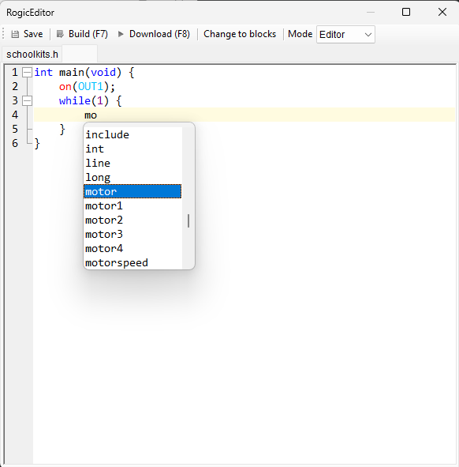

- **Reading the code:**
  - line numbers, a highlighted current line and the Consolas font
  - colors for C keywords, the kit's functions (`motor1`, `delay`, …) and the kit's names (`OUT1`, `IN1`, `REMOCON1`, …)
  - correct colors for `//` and `/* */` comments and for strings
  - `{ }` blocks can be folded with the −/+ in the margin
  - Ctrl+mouse wheel zooms, and Ctrl+0 resets the zoom
- **Brackets:**
  - the bracket matching the one at the cursor lights up, and a bracket with no partner turns red
  - typing `(`, `[`, `{`, `"` or `'` adds the closing one
  - typing the closing one when it is already there just steps over it
  - Backspace in an empty pair deletes both
- **Indentation:**
  - Enter keeps the indent, and goes one level deeper after `{`
  - Enter between `{` and `}` puts the `}` on its own line
  - a `}` typed on an empty line moves back one level
  - Tab and Shift+Tab indent or outdent the selected lines
- **Help while typing:**
  - autocomplete for the kit's functions and C keywords, with the same rules as before
  - typing `(` after a kit function shows how to call it, for example `void motor1(signed char mtSpd);`
- **Shortcuts:**

  | Keys | Action |
  | --- | --- |
  | Ctrl+F | Find (the bar marks every match) |
  | Ctrl+H | Find and replace (Replace all is one undo step) |
  | F3 / Shift+F3 | Next / previous match |
  | Ctrl+G | Go to line |
  | Ctrl+/ | Comment or uncomment the selected lines |
  | Ctrl+D | Duplicate the line |
  | Ctrl+Z / Ctrl+Y | Undo / redo |
  | F7 / F8 | Build / Download, as before |

- **Viewer mode** (the code of the blocks on the canvas) stays read-only and gray. When it refreshes, Ctrl+Z can't bring back an older program.
- **Unchanged:** Build, **Download** (check → blocks → download to the robot) and **Change to blocks**.

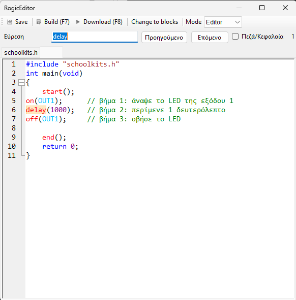

### From C code to blocks

Students can write a program in C and turn it into chips.

1. Open the **RogicEditor** and switch the list at the top left to code editing.
2. Write the program with the kit's commands from `schoolKits.h`, such as `motor()`, `delay()`, servos, sensor inputs, `ledonoff()`, `setSegment()` and `sleep()`.
3. Press **Convert**. Rogic first checks the code with the compiler, then builds the matching chips and loads them onto the canvas.

Pressing **Download** in the editor does the same conversion first and then downloads the blocks to the robot.

- **What converts:** variables, calculations, `if`/`else`, `while` and `for` loops (including `break`), `switch`/`case`, and your own functions.
- **What doesn't:** arrays, pointers, structs, decimal numbers, text in quotes, `do … while` and `goto`.
- **When code can't be converted,** a plain-language message says why (for example "In motor() the speed is 0 to 15." or "You probably meant == (two equals signs)…") and the editor jumps to that line.
- The code editor no longer asks for the teacher code, and no chips are locked by default. **Setup ▸ Teacher unlock…** is still there.

### Downloading

- The download window's progress and error messages were Korean-only. They now show in English or Greek.
- **Clearer error messages** cover these cases:
  - no port found: check the USB cable
  - port already in use by another program
  - robot not responding: check that it is switched on
  - robot didn't answer the start command: make sure nothing else, such as a Bluetooth module, is plugged into the controller's UART pins
- The CP210x driver clean-up only removes Silicon Labs serial-driver entries (`silabser`/`silabenm`).

### Fixes

- Motor-chip times accept a comma as the decimal point (`1,5`). They must be between 0 and 25 seconds, and a wrong value gets a clear message.
- The Color, Contact, IR and Remote dialogs no longer show doubled "Port"/"Color" labels, and the If/Else dialog's labels were rearranged.
- The Start chip and the **Chips2** palette button are drawn from the theme art, so their labels follow the chosen language.

## Requirements

- Windows with **.NET Framework 4.6.2** or newer.
- **No separate compiler install.** The C compiler Rogic uses to build programs (avr-gcc 14.1.0, AVR-Binutils 2.42, AVR-LibC 2.2.0) is bundled in [Toolchain](Toolchain). If that folder is removed, Rogic falls back to any `avr-gcc` installed on the PC.
- **CP210x USB-to-UART driver** for the robot's download cable. The driver is included in [Driver/CP210X](Driver/CP210X): use `Universal` on Windows 10/11 and `Origin` on older systems.

## Running

Run `Rogic.exe` from this folder. The DLLs, `Lib/`, `RogicRes/` and `Toolchain/` must stay next to it. Main window languages: English, Korean, Chinese and Russian. Chips, chip dialogs, menus and download messages: Greek (default) or English.

If Rogic crashes, the error details are written to `runtime_error.log` (or `startup_error.log`) next to `Rogic.exe`.

## Layout

| Path | Contents |
| --- | --- |
| `Rogic.exe` | Main application |
| `ChipsDialogue.dll`, `ClientArea.dll`, `FixedArea.dll`, … | UI, chip dialogs, palette and canvas |
| `ScintillaNET.dll` | Editing control of the C editor ([ScintillaNET](https://github.com/jacobslusser/ScintillaNET) 3.6.3, MIT; Scintilla licence). Licences in `LICENSES/`. A copy is also built into `Rogic.exe`, so Rogic still starts if this file is missing |
| `ISPDownloader.dll`, `STK500.dll` | Program download to the controller |
| `Bluetooth/` | Bluetooth module setup (master/slave pairing) |
| `Lib/` | AVR libraries and headers linked into every program (`libm8Api.a`, `libKitMD2013.a`, `schoolKits.h`) |
| `RogicRes/` | Cursors and icon |
| `Driver/CP210X/` | USB serial driver for the download cable |
| `msvcr100*.dll`, `shared32/64.dll` | Native runtime dependencies |
| `Toolchain/` | Bundled avr-gcc compiler for the ATmega8. Licences are in `Toolchain/LICENSES`, sources are linked in `Toolchain/README_ROGIC.txt` |
| `docs/odigos_schoolkits.pdf` | Guide to programming the kit in C with `schoolKits.h` (LaTeX source: `docs/odigos_schoolkits.tex`) |
| `docs/screenshots/` | The screenshots in this README |
| `LICENSES/` | Licences of ScintillaNET and Scintilla, used by the C editor |

## Notes

The repository holds only compiled binaries, not source code. The reworked parts live in `Rogic.exe`, `ChipsDialogue.dll`, `ClientArea.dll`, `FixedArea.dll` and `ISPDownloader.dll`.
